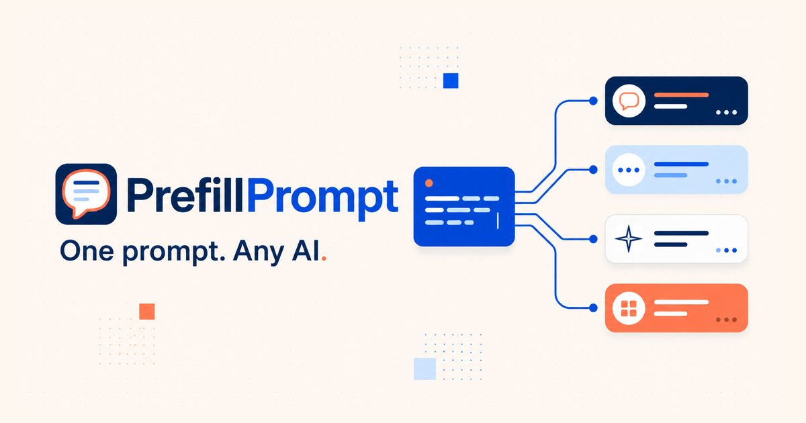

# PrefillPrompt

PrefillPrompt turns a prompt into a shareable link for ChatGPT, Claude, Gemini, or Perplexity. Choose an AI and model in one searchable field, write the prompt, then tap the arrow to copy the link.

> [!IMPORTANT]
> The prompt is part of the URL. Anyone who receives the link—and systems that record URLs—can read it. Do not put secrets or sensitive personal information in a shared prompt.

<p align="center">
  
</p>

## Features

- ChatGPT, Claude, Gemini, and Perplexity destinations
- One provider-and-model combobox, searchable by names such as ChatGPT, OpenAI, Claude, Anthropic, Gemini, or an exact model
- Flexible aliases `latest`, `latest-fast`, and `latest-reasoning`
- A checked-in model catalog refreshed from OpenRouter through tested weekly pull requests
- ChatGPT web-search links
- Experimental temporary or incognito conversation links where the destination supports them
- Copyable URLs and Markdown buttons
- QR-code export and native Web Share where the browser supports it
- Progressively disclosed share formats, conversation options, examples, and browser-local history
- A reliable copy-and-open Gemini handoff when a public deep link cannot preserve the prompt
- A stateless Nuxt application deployed with Cloudflare Workers and Static Assets

History and preferences stay in the current browser. PrefillPrompt does not sync them between devices.

## Privacy

PrefillPrompt has no account system, application database, analytics SDK, or advertising tracker. Preferences and up to six recent prompts are optional browser-local history. The app continues to work when browser storage is denied or full.

Prompt links are not private: the prompt is encoded in the URL and can appear in browser history, clipboards, QR scanners, link previews, network infrastructure, and destination-provider logs. Do not put secrets or sensitive information in a PrefillPrompt URL. See [Privacy and logging](./docs/privacy.md) for the exact storage, request, and logging behavior.

## Try an example

| Destination | Prompt | Link |
| --- | --- | --- |
| ChatGPT with web search | Research the current state of Web Platform Baseline and cite primary sources. | [Open prompt](https://prefillprompt.com/api/prompt?s=chatgpt&model=latest-reasoning&web=true&q=Research%20the%20current%20state%20of%20Web%20Platform%20Baseline%20and%20cite%20primary%20sources.) |
| Claude | Turn these rough release notes into a concise customer announcement. | [Open prompt](https://prefillprompt.com/api/prompt?s=claude&model=latest&q=Turn%20these%20rough%20release%20notes%20into%20a%20concise%20customer%20announcement.) |
| Gemini | Compare three ways to add offline support to a Nuxt app, including tradeoffs. | [Open prompt](https://prefillprompt.com/api/prompt?s=gemini&model=latest-fast&q=Compare%20three%20ways%20to%20add%20offline%20support%20to%20a%20Nuxt%20app%2C%20including%20tradeoffs.) |
| Perplexity | Find primary sources explaining Cloudflare Workers Static Assets routing. | [Open prompt](https://prefillprompt.com/api/prompt?s=perplexity&q=Find%20primary%20sources%20explaining%20Cloudflare%20Workers%20Static%20Assets%20routing.) |

## Prompt-link API

`GET https://prefillprompt.com/api/prompt` redirects the browser to the selected service with the prompt and supported options.

A link redirects straight to its service: the one it names, else the one its model implies, else ChatGPT. The one exception is a prompt that trips a [safety signal](#safety-warnings). That link stops at a preview screen, `/open`, so the reader sees the warning before anything opens.

| Query key | Required | Meaning |
| --- | --- | --- |
| `q` | Yes | The URL-encoded prompt text. Newlines and Unicode are supported. |
| `s` | No | Service ID or recognized service alias. Supported IDs are `chatgpt`, `claude`, `gemini`, and `perplexity`. A provider-specific model may imply its service. With no service, the link opens ChatGPT. |
| `m` | No | Legacy name for the service. It is used only when `s` is absent. New links should use `s`. |
| `model` | No | A provider model ID or the alias `latest`, `latest-fast`, or `latest-reasoning`. |
| `web` | No | Set to `true` or `1` to request ChatGPT web search. |
| `temporary` | No | Set to `true` or `1` to request ChatGPT Temporary Chat or Claude Incognito. Experimental. |

For example:

```text
https://prefillprompt.com/api/prompt?s=chatgpt&model=latest-reasoning&web=true&q=Compare%20the%20latest%20browser%20automation%20standards
```

```text
https://prefillprompt.com/api/prompt?s=chatgpt&temporary=true&q=Help%20me%20brainstorm%20three%20names%20for%20a%20weekend%20prototype
```

### The preview screen

`https://prefillprompt.com/open` takes the same query keys as the API and never redirects on its own. It shows the prompt, any safety warning, and a button for one destination; the other destinations sit behind **Open somewhere else**.

- **Destinations.** ChatGPT website, Claude website, Gemini, and Perplexity, plus two apps on computers: Codex in the ChatGPT desktop app (`codex://new?prompt=`) and Claude Code in a terminal (`claude-cli://open?q=`). Both app links are the vendors' documented forms; they fill the prompt in and wait for the reader to send it. If the app does not take over within a second and a half, the page offers the website. Touch devices are offered websites only, since a phone hands those links to an installed app itself.
- **Remembered choice.** For a link with no `s`, the destination the reader opens is saved in that browser and preselected next time.
- **A named service wins for one visit.** With `s=claude`, the preview opens on Claude and leaves the saved choice alone. The saved choice still decides between app and website.

Link to `/open?s=claude&q=…` directly when you want the preview and the app option even for a clean prompt.

### Safety warnings

Before a shared prompt is opened, PrefillPrompt checks it for traits that mark an attack on the reader or their agent. Two traits show a red warning: telling an agent to send email to a named address, and fake chat-control markers such as `<|assistant|>`. On 6,581 malicious and 17,111 ordinary prompts from public datasets, 99.7% and 99.6% of their matches were malicious. Nine more, such as reading key files or piping a download to a shell, show an amber caution. Well-known phrases such as "ignore all previous instructions" are not flagged: 64% of their matches were ordinary shared templates.

- Plain explanations with real examples: `https://prefillprompt.com/safety`
- The patterns: [`src/lib/prompt-safety.ts`](src/lib/prompt-safety.ts)
- 100 real example prompts with sources: [`src/data/safety/dangerous-prompts.json`](src/data/safety/dangerous-prompts.json)
- Method, numbers, and limits: [`docs/research/prompt-danger-signals-2026-11-12.md`](docs/research/prompt-danger-signals-2026-11-12.md)
- To re-measure: `node scripts/safety/fetch.mjs`, then `node --experimental-strip-types scripts/safety/measure.mjs` and `scripts/safety/build-examples.mjs`. A test fails if a warning's tier no longer matches its measurement.

A prompt with no warning is not proven safe. The checks are plain patterns and are easy to evade.

### Provider caveats

PrefillPrompt launches third-party web applications; those applications do not provide a single stable, documented URL API for every model and mode.

- Model and mode controls are best-effort. A service may ignore an option, fall back to its default, rename a model, or require a particular account, plan, region, or feature rollout.
- The `latest*` aliases intentionally move to the latest known-good mapping. Use an explicit model ID when reproducibility matters.
- `web` currently targets ChatGPT web search. Other services choose their own search behavior.
- `temporary` currently maps to ChatGPT Temporary Chat and Claude Incognito. Gemini and Perplexity have no verified URL switch for this mode.
- Gemini does not publish a dependable third-party prompt-link contract. Gemini links use a one-tap copy-and-open handoff so the prompt is not silently dropped.
- Gemini and Perplexity do not publish stable URL controls for selecting consumer models or modes, so those destinations may use their account defaults.
- Temporary or incognito mode is not a privacy guarantee. Confirm the destination UI shows the requested mode before sending sensitive content.
- The OpenRouter catalog is useful for discovering model names, but it is not authoritative for consumer web-app URL controls. PrefillPrompt does not treat OpenRouter availability as proof that a model can be selected by URL.

## Local development

```bash
git clone https://github.com/ThatGuySam/prefillprompt.git
cd prefillprompt
pnpm install
pnpm dev
```

The development server is available at `http://localhost:3000`.

The repository requires Node 22.13 or newer within the Node 22 release line, or Node 24 and newer, for development and Cloudflare commands. `.node-version` pins Node 22.16.0, and Corepack reads the pinned pnpm version from `package.json`.

## Feature flags

Unfinished work lives on `main` behind build-time flags in `src/lib/flags.ts`. A flag is off unless the build sets its environment variable, so a normal production build ships with every flag off.

| Flag | Turn on with | What it adds |
| --- | --- | --- |
| `providerCompatibility` | `NUXT_PUBLIC_PROVIDER_COMPATIBILITY=true` | The July 2026 builder: a "recipient decides" option, the `/choose` page, compatibility notices, a warning when a prompt contains an API key or other secret, and web search sent as prompt text instead of the ChatGPT `hints` parameter. |

Try a flag locally with `NUXT_PUBLIC_PROVIDER_COMPATIBILITY=true pnpm dev`. With the flag off, the live builder components (`PromptBuilder`, `MoreSheet`, `ModelCombobox`) are the ones that render; the flagged versions are the files ending in `Next.vue`. `test/flags-off.test.ts` holds the flag-off behavior in place.

## Commands

| Command | Purpose |
| --- | --- |
| `pnpm dev` | Start the Nuxt development server. |
| `pnpm build` | Create the standard production build. |
| `pnpm build:cloudflare` | Build Nuxt for Cloudflare Workers and Static Assets. |
| `pnpm preview` | Preview the Cloudflare-targeted build locally. |
| `pnpm lint` | Run ESLint. |
| `pnpm models:update` | Validate OpenRouter's public endpoint and update the checked-in model catalog when its model set changes. |
| `pnpm typecheck` | Run Nuxt and Vue TypeScript checks. |
| `pnpm test` | Run the automated test suite once. |
| `pnpm probe` | Check the live `/api/prompt` contract, error codes, and key pages. Pass `--base <origin>` to target a preview. |
| `pnpm probe:providers` | Same, plus a reachability check of each AI destination. |
| `pnpm check` | Run lint, typecheck, tests, and the Cloudflare build. |
| `pnpm deploy:preview` | Upload a Cloudflare Worker version and print its preview URL without promoting it to production. |
| `pnpm deploy:blue` | Build and upload the named blue Cloudflare preview. |

Before sharing a Cloudflare preview:

```bash
pnpm check
pnpm deploy:preview
```

Review the emitted preview URL, including the homepage and each redirect path, before any production rollout.

## Checking the live links

`pnpm probe` sends real requests to `https://prefillprompt.com/api/prompt` and compares each redirect with an expected destination written out in `scripts/probe/cases.mjs`. `test/probe-cases.test.ts` keeps those expectations in sync with `src/lib/prompt-links.ts`, so changing a link format on purpose means updating both. A scheduled workflow (`.github/workflows/probe.yml`) runs it daily and fails when the contract drifts.

Plain HTTP proves that PrefillPrompt builds the right URL. It cannot prove that ChatGPT, Claude, Gemini, or Perplexity still honor `model`, `thinking`, `hints`, `temporary-chat`, or `incognito`, because those sites apply them in the browser after login, and their bot checks block automated browsers. [docs/manual-link-check.md](docs/manual-link-check.md) lists a clickable link for each feature with the expected result, so you can check them in your own browser.

## Architecture

- Nuxt renders the responsive prompt builder and browser-local state.
- A shared provider registry resolves services, models, aliases, and supported modes.
- The browser bundle reads a generated model catalog; the application does not depend on OpenRouter at runtime.
- The Nitro `/api/prompt` route validates a link and returns an uncached redirect without storing the prompt.
- Gemini requests redirect to a first-party clipboard handoff because the consumer app has no documented public prompt-link contract.
- Cloudflare serves prerendered frontend assets first and invokes the Worker for API routes.

## Contributing

1. Fork and clone the repository.
2. Create a focused branch.
3. Make the change and add or update tests.
4. Run `pnpm check`.
5. Open a pull request describing the behavior change and verification.

## License

PrefillPrompt is open-source software available under the [MIT License](./LICENSE).
